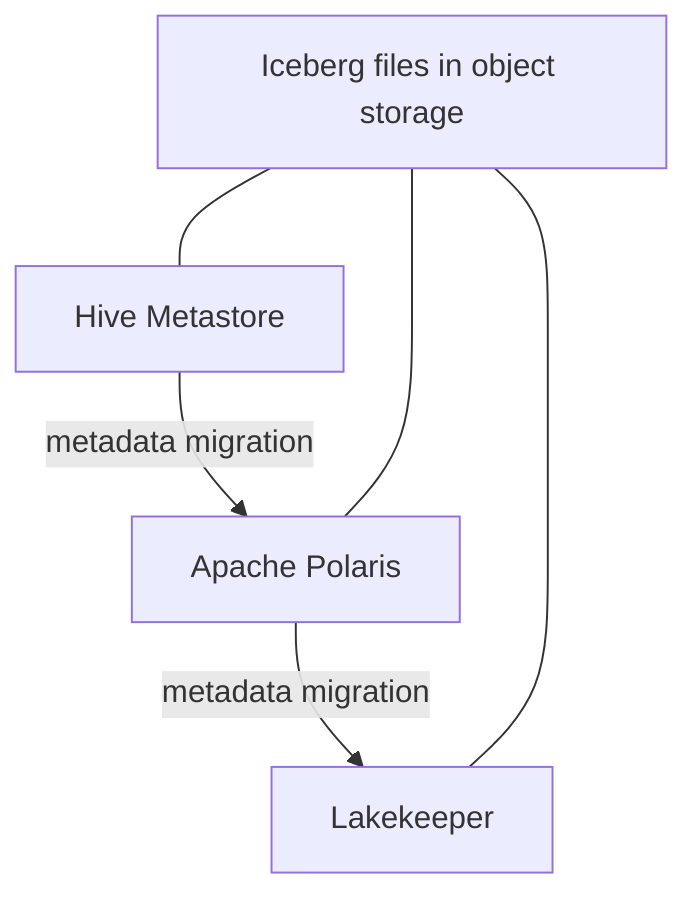

# Architecture

## Scope

The repository owns catalog registration migration and verification. Object data remains in the same S3-compatible prefix throughout the process.

## Runtime components

| Component | Responsibility | Durable state |
| --- | --- | --- |
| Hive Metastore | Source catalog for the first path | PostgreSQL |
| Apache Polaris | Target for the first path and source for the second | PostgreSQL |
| Lakekeeper | Target for the second path | PostgreSQL |
| MinIO | Local S3-compatible data plane | Named volume |
| Spark | Deterministic seed and independent validation | None |
| Catalog Migrator | Registration dry-run and migration | Generated reports |

## Storage invariant

All catalogs resolve tables below `s3://warehouse/migration`. The migration changes catalog ownership of registrations, not Iceberg metadata or data files.

The local Polaris catalog uses both the external MinIO endpoint and the internal Compose endpoint. The local Lakekeeper warehouse uses the same bucket and key prefix with remote request signing backed by stored local credentials. This is a development topology, not a production credential model.

## Persistence

Polaris runs with relational JDBC persistence. Lakekeeper and Hive Metastore use separate PostgreSQL databases. Each database has its own Compose volume so restarts do not silently reset catalog state.

## Safety model

The migration command is unavailable without an explicit confirmation variable. Dry-run is always a separate operation. The end-to-end workflow then applies four independent checks:

1. The target exposes the exact expected table inventory.
2. Schema, location, create statement, and row fingerprints match.
3. Snapshot and data-file fingerprints match.
4. Source registrations are absent after migration.

## Deliberate exclusions

Kafka, RisingWave, domain pipelines, dashboards, Spark Connect, and incomplete Kubernetes overlays are not part of catalog migration. Removing them makes the supported contract small enough to test exhaustively.
